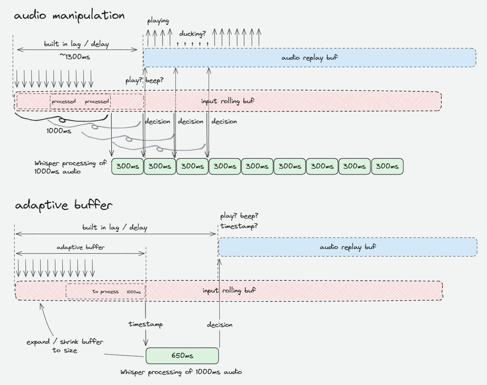

# PottyMuter — mute unwanted words in your live audio

PottyMuter is an OBS Studio audio filter that runs a local AI speech model
(Whisper) in real time, recognizes words *before* they reach your viewers,
and replaces unwanted ones (profanity, filler words — anything you
configure) with silence, a beep or a custom sound.

PottyMuter is **Russian-first**: out of the box it ships a morphology-aware
Russian profanity list, Cyrillic-friendly text preprocessing and model
defaults tuned for Russian speech.

> **This is a fork of [obs-cleanstream](https://github.com/locaal-ai/obs-cleanstream)** by
> [Roy Shilkrot](https://github.com/royshil) ([locaal-ai](https://github.com/locaal-ai)),
> licensed under **GPL-2.0**. The upstream project has not seen active
> maintenance recently; this fork continues the idea with a focus on the
> Russian language, recognition accuracy/speed, and bug fixes.
> All credit for the original concept and code goes to the upstream authors —
> see [Attribution](#attribution--license).

[](https://github.com/mtnson/obs-pottymuter/actions/workflows/push.yaml)
[](https://github.com/mtnson/obs-pottymuter/releases)

## What this fork changes / plans to change

- [x] Plugin renamed to **PottyMuter** (user-facing name, filter ID, packaging)
- [x] CI builds feature branches so every push is verifiable
- [x] Bug fixes for issues found with the original filter (validated model
      downloads, duplicate-download dedupe, honest error reporting)
- [x] Unicode-aware Cyrillic preprocessing (case folding, `ё`→`е`) before
      the detection regex
- [x] Protection against incompatible "pruned" models (detection by ggml
      header, hiding from the model list, refusal before download/loading —
      they crash upstream OBS builds on inference)
- [ ] Russian profanity list by default (root-based regex with word-boundary
      handling; handles ё→е spelling variants, case, stretched forms)
- [ ] Russian-tuned defaults: `Whisper Small q5 (181Mb)`, language `ru`,
      silence on match
- [ ] Recognition accuracy and inference speed improvements for Russian
- [ ] Curated model catalog (Russian-relevant models only)
- [ ] Full `ru-RU` localization (alongside the upstream `en-US`)

Details per version: [CHANGELOG.md](CHANGELOG.md).

## Usage

- Add the filter to any audio-generating source in OBS
- Enable advanced settings and pick your Whisper model, language and
  detection regex
- Live audio now goes through the filter before being broadcast

## Download

Grab the latest build from the
[releases page](https://github.com/mtnson/obs-pottymuter/releases):
Windows builds come as a zip archive and an installer, in `generic`,
`nvidia` (CUDA) and `amd` (ROCm) variants. Latest release:
**[0.2.1](https://github.com/mtnson/obs-pottymuter/releases/tag/0.2.1)**.

## Requirements

- OBS version 31+ → plugin versions 0.2.x (built and tested on OBS 31.1.1)
- OBS version 30+ → plugin versions 0.0.4+
- OBS version 29 → plugin versions 0.0.2+
- OBS version 28 → plugin versions 0.0.1

Older OBS versions are not supported — the plugin uses newer APIs.

## Method

Whisper runs in real time on small chunks of the incoming audio. For each
chunk it produces a decision that determines whether the audio output plays
the original audio or e.g. a beep or silence. Processing happens in a
separate thread, with a built-in adaptive delay to keep the decision
(play/beep/silence) in sync with the actual audio playback based on
timestamps — the delay adapts because some systems (e.g. with CUDA) decide
faster.



It uses [OpenAI Whisper](https://github.com/openai/whisper) for speech
recognition, run locally and efficiently via
[Whisper.cpp](https://github.com/ggerganov/whisper.cpp), with
[Silero VAD](https://github.com/snakers4/silero-vad) (ONNX) to skip silent
chunks.

## Building

The build pipelines are driven by CI, but every target can be built locally
with the very same scripts.

Start by cloning this repository (with submodules):

```sh
git clone --recursive https://github.com/mtnson/obs-pottymuter.git
```

### Windows

Prerequisites: PowerShell 7, Visual Studio 2022 Build Tools (C++ workload,
includes CMake). Inno Setup 6 is only needed for installer packaging.

For the local edit-build-test loop there is a helper script that builds with
the same settings CI uses and deploys the result straight into your OBS
installation (overwrites the installed `obs-pottymuter.dll` and its runtime
dlls, so restart OBS after running it):

```powershell
> .\dev-build.ps1                          # generic CPU, RelWithDebInfo
> .\dev-build.ps1 -Acceleration nvidia     # CUDA variant
```

To debug: build once with the default `RelWithDebInfo`, run the script, then
in Visual Studio use Debug → Attach to Process → `obs64.exe` (the PDB files
deployed next to the DLL provide symbols).

Set the `ACCELERATION` environment variable to `generic`, `nvidia`, or `amd`
if you want to drive `.github/scripts/Build-Windows.ps1` manually.
`nvidia` includes CUDA support, `amd` includes ROCm support via hipblas, and
all variants include Vulkan and OpenBLAS support.

```powershell
> $env:ACCELERATION = "generic"
> .github/scripts/Build-Windows.ps1 -Configuration Release
```

The first configure downloads dependencies (`obs-deps`, Qt6, OBS sources)
into `.deps/` automatically — one-time cost, cached afterwards.

The build lands in the `./release` folder off the root. Install manually:

```powershell
> Copy-Item -Recurse -Force "release\Release\*" -Destination "C:\Program Files\obs-studio\"
```

### macOS

Set `MACOS_ARCH` to `x86_64` or `arm64`, then:

```sh
export MACOS_ARCH="arm64"
./.github/scripts/build-macos.zsh
```

Copy the plugin files from `./release` to
`/Users/you/Library/Application Support/obs-studio/obs-plugins`.

### Linux (Ubuntu-ish)

Distributions binaries: `generic`, `nvidia` (CUDA) or `amd` (ROCm/hipblas);
all include Vulkan, OpenCL and OpenBLAS support.

```sh
export ACCELERATION="nvidia"
./.github/scripts/build-linux.sh
```

## Attribution & License

PottyMuter is built on **obs-cleanstream** by
[Roy Shilkrot](https://github.com/royshil):

- Upstream project: <https://github.com/locaal-ai/obs-cleanstream>
- Author: Roy Shilkrot ([roy.shil@gmail.com](mailto:roy.shil@gmail.com))
- Video walkthrough of the code: <https://youtu.be/HdSI3sUKwsY>
- Original OBS Forums resource:
  <https://obsproject.com/forum/resources/cleanstream-remove-uhs-ums-profanity-in-your-live-stream-or-recording-with-ai.1732/>

Acknowledgments kept from upstream:

- [Whisper.cpp](https://github.com/ggerganov/whisper.cpp) by
  [ggerganov](https://github.com/ggerganov) — efficient local Whisper inference
- [Silero VAD](https://github.com/snakers4/silero-vad) — voice activity detection

Licensed under **GPL-2.0** — the same license as the original project, as
required. The license text is in [LICENSE](LICENSE); original copyright
notices are preserved in all source files.
